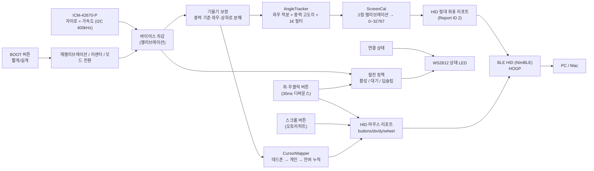
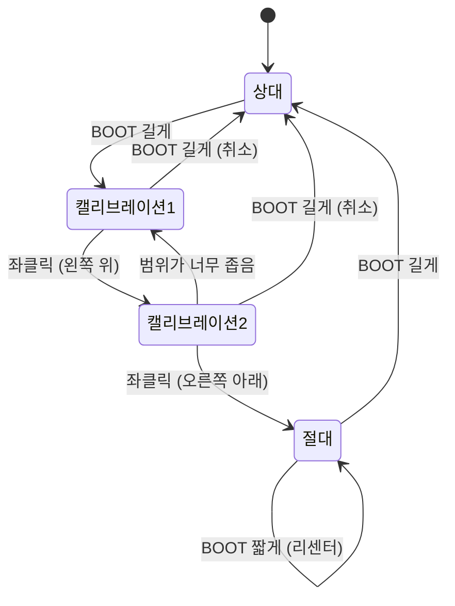

# 코드 구조

## 데이터 흐름



## 모듈

| 파일 | 역할 |
|---|---|
| [main.rs](../firmware/src/main.rs) | 초기화 순서와 100Hz 메인 루프 |
| [imu.rs](../firmware/src/imu.rs) | ICM-42670-P 설정·읽기, 자이로 바이어스 캘리브레이션 |
| [orientation.rs](../firmware/src/orientation.rs) | 중력 방향 추정, 기울기 보정, 고도각, 바이어스 추적. 순수 계산 |
| [pointer.rs](../firmware/src/pointer.rs) | 절대 좌표: 1€ 필터, 각도 추적, 화면 캘리브레이션. 순수 계산 |
| [mapping.rs](../firmware/src/mapping.rs) | 각속도 → 커서 이동량. **튜닝 상수가 여기 모여 있음** |
| [ble_hid.rs](../firmware/src/ble_hid.rs) | BLE HID 마우스 — 리포트 디스크립터, 광고, 전송 |
| [button.rs](../firmware/src/button.rs) | 버튼 디바운스 + 스크롤 오토리피트 |
| [status_led.rs](../firmware/src/status_led.rs) | WS2812 상태 표시 |
| [power.rs](../firmware/src/power.rs) | 절전 정책: 언제 대기·딥슬립에 들어갈지. 순수 계산 |
| [sleep.rs](../firmware/src/sleep.rs) | ESP-IDF 전원 관리: 자동 라이트 슬립 설정, 딥슬립 진입·복귀, USB 호스트 감지 |

## 부팅 순서

`main()`의 초기화 순서에는 이유가 있습니다.

1. **전원 관리 설정** — CPU 클럭 자동 조절과 자동 라이트 슬립을 켭니다. BLE 컨트롤러가 초기화되기 전에 해야 합니다 (ESP-IDF BLE 절전 예제와 같은 순서).
2. **상태 LED** — 이후 단계가 실패해도 사용자가 진행 상황을 볼 수 있습니다.
3. **BLE 광고 시작** — 캘리브레이션(약 1.6초) 동안 호스트가 미리 연결을 시도할 수 있습니다.
4. **I2C + IMU 초기화**
5. **자이로 캘리브레이션** — LED 주황. 이 구간에 보드가 움직이면 안 됩니다. 딥슬립에서 깨어난 경우에는 건너뛰고 잠들기 전 영점을 씁니다 ([전원 관리](#전원-관리)).
6. **버튼 초기화 후 메인 루프 진입**

## 메인 루프 (100Hz)

매 10ms마다 (대기 중인 상대 모드는 50ms마다, [전원 관리](#전원-관리) 참고). 주기는 "10ms 쉬기"가 아니라 **직전 기상 시각 + 10ms까지 쉬기**(`xTaskDelayUntil`)로 맞춥니다. 처리 시간과 라이트 슬립에서 깨어나는 시간이 주기 안에 흡수되어야 틱으로 세는 스크롤 반복과 틱당 이동량으로 보내는 커서 속도가 일정합니다 ([전원 관리의 고정 주기](#고정-주기-루프)).

매 틱마다:

1. 자이로를 읽고 바이어스를 뺍니다.
2. `CursorMapper`로 `(dx, dy)`를 계산합니다.
3. 버튼 상태를 디바운스합니다.
4. 연결 상태에 따라 LED를 갱신합니다.
5. 리포트를 보냅니다 — **단, 보낼 이유가 있을 때만.**

```rust
if dx != 0 || dy != 0 || wheel != 0 || buttons != prev_buttons {
    mouse.send(&report);
}
```

움직임도 휠도 버튼 변화도 없는 틱에는 보내지 않아 BLE 대역폭과 전력을 아낍니다. 두 가지를 구분해야 합니다.

- **버튼 상태가 바뀌면 이동량이 0이어도 반드시 보냅니다.** 뗌(release) 리포트가 누락되면 호스트는 버튼이 계속 눌린 것으로 인식해 드래그가 풀리지 않습니다.
- **버튼을 누르고만 있는 동안은 보내지 않습니다.** 호스트가 버튼 상태를 기억하므로 같은 리포트를 반복할 이유가 없습니다. 처음에는 "리포트가 전부 0이 아니면 보낸다"로 짰다가, 버튼을 누른 채 가만히 있으면 같은 리포트가 초당 100번 나가는 것을 실기기 테스트에서 발견해 고쳤습니다.

휠은 상대값이라 오토리피트가 발동한 틱에만 ±1이 실리고, 그 외에는 0이라 자동으로 전송에서 빠집니다.

## 버튼

`Button`은 `PinDriver<'d, Input>`를 들고 있는데, 이 타입이 핀 종류를 지우기 때문에 **어느 GPIO를 쓰든 같은 타입**이 됩니다. 덕분에 버튼 5개를 특별한 제네릭 없이 같은 방식으로 다룹니다.

두 가지 상태를 구분해 제공합니다.

- `pressed()` — 누르고 있는 동안 계속 참. 클릭과 드래그에 씁니다.
- `just_pressed()` — 눌린 순간 한 틱만 참. 재캘리브레이션처럼 한 번만 실행할 동작에 씁니다.

`Repeater`는 스크롤 버튼용 오토리피트입니다. 눌린 순간 즉시 한 칸을 내보내고(톡 누름에 바로 반응), 계속 눌려 있으면 지연 시간 뒤부터 일정 간격으로 반복합니다. 타이머 없이 메인 루프 틱을 세는 방식이라 별도 스레드가 필요 없습니다.

## 현장 재캘리브레이션

BOOT 버튼을 누르면 루프 안에서 바로 `calibrate_gyro`를 다시 돌립니다. 자이로가 이미 워밍업된 상태라 부팅 때(60개)보다 폐기 샘플을 적게(10개) 잡습니다.

이때 **실패해도 앱을 종료하지 않습니다.** 부팅 시 캘리브레이션은 `?`로 전파해 실패를 크게 드러내지만, 버튼으로 부른 재캘리브레이션이 같은 방식으로 실패하면 마우스 자체가 죽어버립니다. 그래서 경고만 남기고 기존 바이어스를 유지합니다.

## 자이로 캘리브레이션

`Imu::calibrate_gyro(discard, samples)` — 앞 `discard`개를 버리고, 유효 샘플 `samples`개의 평균을 바이어스로 씁니다.

핵심은 **유효 샘플 판정**입니다. 어느 축이든 20dps를 넘으면 정지 상태로 보지 않고 평균에서 제외합니다. 전원 인가 직후 자이로가 뱉는 풀스케일 포화값(±2000dps)이 평균에 섞이는 것을 막기 위해서입니다 — 200샘플 중 2개만 섞여도 바이어스가 20dps 틀어지고, 그러면 정지 상태에서 커서가 계속 흐릅니다.

자세한 배경은 [하드웨어 문서](hardware.md#전원-인가-직후-포화값-주의)에 있습니다.

## 기울기 보정

자이로는 **보드 기준 축**으로 회전을 잽니다. 손으로 쥐면 손목이 보드를 옆으로 기울이게(roll) 되는데, 그 상태로 좌우로 돌리면 실제 좌우 회전이 보드의 Z축과 X축에 나눠 담깁니다. 보드 축을 그대로 쓰면 **커서 방향이 기울인 각도만큼 정확히 틀어집니다** (30° 기울여 쥐면 수평 동작이 30° 비스듬히 감).

그래서 가속도계로 중력 방향("위")을 추정하고, 회전 속도를 실제 기준으로 다시 나눕니다.

- 좌우축 = "위"에서 가리키는 축 성분을 뺀 방향 (가리키는 축에 수직인 평면 위의 "위")
- 상하축 = 가리키는 축 × 위 — 수평이면서 가리키는 방향에 수직인 축

두 축 모두 **가리키는 축에 수직**이라는 게 핵심입니다. 그래서 보드를 옆으로 기울여 쥐어도 방향이 맞고, 위·아래를 가리킨 채 손목을 비틀어도(가리키는 축 둘레 회전) 커서가 움직이지 않습니다. 보드가 수평이면 기존 축(Z, X)과 완전히 같습니다.

### 처음 구현의 결함: 비틀기 누설

처음에는 좌우축으로 "위"를 그대로 썼습니다. 수평으로 쥐면 문제가 없지만, **위나 아래를 가리킨 채 손목을 비틀면 그 회전의 sin(고도각)만큼이 좌우로 새어 들었습니다.** 가리키는 방향은 그대로인데 커서가 옆으로 가는 거죠. 고도각 30°면 비튼 각도의 절반입니다.

실사용 로그를 보면 보드를 위로 20~30° 들어 가리키고, 쓰는 동안 손목 기울기가 25~30°씩 변했습니다. 같은 곳을 가리켜도 좌우 각도가 10° 가까이 어긋날 수 있는 조건이라, 절대 좌표 모드에서 커서가 한쪽으로 치우치고 캘리브레이션 결과가 매번 달랐습니다. 수평 자세만 테스트해서 놓친 결함입니다.

### 중력 추정: 상보 필터

가속도계만 쓰면 손을 휘두를 때의 선형 가속에 흔들리고, 자이로만 쓰면 적분 오차가 쌓입니다. 그래서 둘을 섞습니다.

1. 매 틱 자이로로 "위" 벡터를 회전시킵니다 (`du/dt = u × ω`). 빠른 움직임을 즉시 따라갑니다.
2. 가속도 크기가 1g ±0.15 안일 때만 가속도계 방향으로 2%씩 끌어당깁니다 (시상수 약 0.5초). 손을 휘두르는 중이면 건너뜁니다.

### 수치 검증

`orientation.rs`는 ESP-IDF에 의존하지 않아 호스트에서 테스트할 수 있습니다. 회전 행렬로 여러 자세를 만들어 확인했습니다.

- 고도각 3가지 × 기울기 6가지 = 18개 자세 모두에서 순수 좌우 회전은 좌우로만, 순수 상하 회전은 상하로만 감
- **위·아래를 가리킨 채 비틀기 → (0, 0)** (이전 방식은 sin(고도각)만큼 샘)
- **닫힌 경로 후 방위각**: 위로 든 채 비틀고, 돌리고, 내리고, 다시 비틀어 원래 자리를 가리키면 새 방식은 **−0.001°**, 이전 방식은 **+6.71°** (정답 0°)
- 수평일 때 기존 축과 동일
- 보정 전 방식의 방향 오차가 기울기 각도와 정확히 같음 (진단 확인)
- 자이로 전파 부호, 가속도계 수렴, 1.5g 이상 차단, 움직이는 중 자이로·가속도계 일치

루프 주기는 10ms 대기 + 처리 시간이라 고정값 대신 실측한 `dt`로 적분합니다. 실측하면 FreeRTOS 틱에 맞물려 정확히 10.0ms가 나옵니다.

## 절대 좌표 모드

상대 이동 모드는 OS 포인터 가속과 화면 끝 클램프 때문에 각도와 커서 위치의 대응이 원리적으로 유지되지 않습니다. 커서가 화면 끝에 닿은 뒤에도 손을 계속 돌리면 보드 방향과 커서가 영영 어긋나죠. 절대 좌표 모드는 가리키는 각도를 화면 위치로 직접 바꿉니다.

### 모드 상태



BOOT 버튼 하나에 두 동작을 싣기 위해 `HoldGesture`로 누름 시간을 구분합니다. 길게 누름은 1.5초에 닿는 순간 바로 발생해 손을 떼기 전에 LED가 바뀌고, 짧게 누름은 뗄 때 판별됩니다. 그래서 상대 모드의 재캘리브레이션도 이제 손을 뗄 때 시작합니다.

### 각도 추적

- **좌우**: 가리키는 방향의 **방위각 변화율**을 적분합니다. 좌우 각속도를 cos(고도각)으로 나눈 값으로, 방위각의 정확한 시간 미분이라 **움직인 경로와 무관하게 같은 곳을 가리키면 같은 각도**가 나옵니다. 수직인 화면에서 가로 위치는 방위각으로 정해지므로 이게 맞는 양입니다. 0.3°/s 미만은 쌓지 않아(`ABS_YAW_GATE_DPS`) 정지 시 남은 자이로 오차로 흐르지 않습니다. 하드 게이트라 그보다 빠른 실제 움직임은 크기 손실 없이 그대로 쌓입니다.
- **상하**: 중력 기준 고도각(`asin(가리키는 축 · 위)`)을 그대로 씁니다. 적분이 아니라서 흐르지 않습니다. 보드를 옆으로 기울여도 고도각은 바뀌지 않습니다.

자력계가 없어서 좌우에는 절대 기준이 없습니다. 남는 드리프트는 리센터로 바로잡습니다.

### 1€ 필터

절대 모드는 손떨림이 커서 위치에 그대로 보입니다. 고정 저역통과 필터는 떨림을 없애려면 지연이 커지고, 지연을 줄이면 떨림이 남습니다. [1€ 필터](https://gery.casiez.net/1euro/)는 움직임 속도에 비례해 차단 주파수를 올려 둘을 함께 잡습니다. 정지 시 1Hz로 강하게 거르다가, 60°/s로 움직이면 약 19Hz까지 올라가 지연이 거의 없어집니다.

### 버튼을 누르는 순간의 흔들림

버튼을 누르면 보드가 흔들리고, 디바운스(30ms) 때문에 눌림 인식도 늦습니다. 그래서 캘리브레이션 모서리와 리센터 기준은 **눌림이 인식된 순간보다 5틱(50ms) 앞선 각도**를 씁니다. `AngleTracker`가 최근 16틱의 각도를 보관합니다.

### 캘리브레이션 중의 좌클릭

캘리브레이션 단계를 진행하는 좌클릭이 Mac으로 가면 엉뚱한 곳이 클릭됩니다. 캘리브레이션 중에는 HID 출력을 아예 막고, 마지막 좌클릭으로 절대 모드에 들어간 직후에도 버튼을 뗄 때까지 좌클릭을 삼킵니다(`swallow_left`). 안 그러면 절대 모드 첫 틱에 오른쪽 아래 모서리가 클릭됩니다.

## 바이어스 추적

부팅 캘리브레이션 뒤에도 0.1°/s 수준의 자이로 바이어스가 남고, 보드가 데워지면 조금씩 바뀝니다. 상대 모드에선 데드존이 가려주지만 각도를 적분하는 절대 모드에선 이게 곧 드리프트 속도입니다.

`BiasTracker`는 최근 1초(100샘플) 동안 **자이로 원시값의 흔들림 폭(최대−최소)이 모든 축에서 1°/s 미만**이고, **가속도 각 축의 흔들림 폭이 0.02g 미만**이며, 가속도 크기가 1g ±0.05일 때 정지로 판정합니다. 정지 중에는 그 1초 평균 쪽으로 영점을 시상수 약 1초로 옮깁니다. 가속도 조건은 자이로 값이 일정해도 중력 방향이 바뀌는 느린 회전을 걸러내기 위한 것입니다. 다만 수직축 둘레 회전은 중력 방향이 변하지 않아 걸러내지 못합니다.

### 처음 설계의 결함

처음에는 "**보정한** 각속도가 0.8°/s 미만이면 정지"로 판정했습니다. 그런데 손에 든 채 재캘리브레이션하는 바람에 영점이 (+3.84, +3.31, −0.34)로 4°/s 가까이 틀어지자, 보드를 책상에 놓아도 보정값이 4°/s로 보여 **정지로 인식하지 못하고 영영 보정하지 않았습니다.** 그동안 절대 모드 각도가 초당 0.6°씩 흘러, 오른쪽 끝에 갔다 올 때마다 왼쪽 끝을 가리키려면 점점 더 멀리 가야 했습니다.

원시값의 흔들림 폭은 영점이 얼마나 틀어졌든 상관없으니 이런 경우도 스스로 바로잡습니다. 같은 잘못된 영점에서 시작하는 호스트 시뮬레이션에서 보드를 내려놓으면 10초 안에 오차가 5.71°/s → 0.009°/s로 줄었습니다. 손떨림(8Hz, ±1.5°/s)이나 중력 방향이 바뀌는 3°/s 회전은 정지로 판정하지 않습니다.

### 캘리브레이션의 움직임 검사

`calibrate_gyro`는 받아들인 샘플의 흔들림 폭이 어느 축이든 2°/s를 넘으면 보드가 움직인 것으로 보고 실패합니다. 위 사고처럼 20°/s 문턱 아래의 움직임이 평균에 섞이는 것을 막습니다.

- **BOOT 재캘리브레이션**: 실패하면 기존 영점을 그대로 둡니다. 길게 누르려다 일찍 떼서 손에 든 채 재캘리브레이션이 되어도 영점이 망가지지 않습니다.
- **부팅**: 5번까지 다시 시도하고, 끝내 실패하면 검사 없이 받아들입니다. 남는 오차는 보드를 내려놓았을 때 바이어스 추적이 바로잡습니다.

## 커서 매핑

`CursorMapper::update(yaw_dps, pitch_dps)`가 세 단계를 거칩니다.

1. **데드존** — 문턱 미만은 0. 문턱을 넘으면 문턱만큼 빼서 0에서 연속으로 이어지게 합니다(값이 튀지 않도록).
2. **게인** — `GAIN`을 곱하고 부호를 적용합니다.
3. **잔여 누적** — `f32` 누적기에 더한 뒤 정수 부분만 꺼내 보내고 소수부는 남깁니다. 리포트당 1카운트 미만인 느린 움직임도 여러 리포트에 걸쳐 반영됩니다.

## BLE HID

리포트 디스크립터에 포인터 두 개를 선언합니다.

| Report ID | 내용 | 쓰는 모드 |
|---|---|---|
| 1 | 3버튼 + X/Y **상대** 이동(i8) + 휠 | 상대 (절대 모드의 휠도) |
| 2 | **펜 디지타이저**: 팁 스위치(좌) + 배럴 스위치(우) + 인레인지 + X/Y **절대** 좌표(u16) | 절대 |

모드에 따라 해당 리포트만 보냅니다. 상대 모드에서 절대 모드로 바꿀 때 버튼이 눌려 있으면 떼는 리포트를 보내고, 절대 모드를 끝낼 때는 펜이 근접 범위를 벗어났다(인레인지 0)고 알려 스위치를 정리합니다. 절대 좌표는 필터가 수렴한 뒤의 미세한 흔들림으로 매 틱 나가지 않도록 2 단위(1920px 화면에서 0.1px) 이상 바뀔 때만 보냅니다.

### 왜 절대 쪽이 펜인가: macOS의 버튼 처리

처음에는 절대 쪽도 일반 마우스(Button 페이지 버튼 + 절대 X/Y)로 선언했는데, macOS에서 **클릭이 여러 번 되는 것처럼 느껴지고 드래그가 전혀 되지 않았습니다.** macOS의 HID 드라이버(IOHIDFamily의 [IOHIDEventDriver.cpp](https://github.com/apple-oss-distributions/IOHIDFamily/blob/main/IOHIDFamily/IOHIDEventDriver.cpp)) 소스를 읽어 원인을 확인했습니다.

1. `parseElements`는 Button 페이지 버튼을 따로 모았다가, **장치에 상대 이동 요소가 하나라도 있으면 전부 상대 포인터에 붙입니다.** 절대 컬렉션의 버튼까지요.
2. 절대 X/Y는 마우스 컬렉션 안에 있어 조이스틱 경로(`checkMultiAxisElement`가 마우스 컬렉션 제외)에도, 상대 경로에도 맞지 않아 **버튼 없는 스타일러스 트랜스듀서**가 됩니다.
3. `handleRelativeReport`는 버튼 상태를 계산할 때 **방금 온 리포트인지 따지지 않고 모든 버튼 요소의 마지막 값**을 씁니다. 절대 리포트의 버튼도 붙어 있으니 절대 리포트가 와도 상대 이벤트가 발생합니다.

그래서 절대 리포트 하나마다 상대 이벤트(버튼 눌림)와 스타일러스 이벤트(버튼 0)가 연달아 나가 **눌림/뗌이 반복**됐습니다. 누르는 동안 손떨림으로 좌표가 계속 바뀌니 초당 수십 번입니다. 상대 모드에서는 반대로, 나중에 처리되는 절대 쪽 버튼의 옛 값(0)이 눌림을 덮어씁니다.

펜의 팁·배럴 스위치는 **Digitizer 페이지**라 `parseDigitizerElement`가 먼저 가져가 디지타이저 경로에 남습니다. 상대 포인터에는 Report ID 1의 버튼만 붙고, 펜 이벤트에는 팁(bit0)·배럴(bit1)이 버튼 상태로 제대로 실립니다.

펜 리포트에는 휠이 없습니다. 디지타이저 컬렉션 안의 휠은 디지타이저 파서가 가져가지만 처리하지 않기 때문입니다. 그래서 절대 모드의 휠은 Report ID 1로 보냅니다.

**우클릭도 Report ID 1로 보냅니다.** 실측해 보니 이 Mac의 드라이버는 펜의 배럴 스위치를 오른쪽 버튼으로 인식하지 않았습니다(22번 눌러 맥OS가 인식한 오른쪽 버튼 0번). 좌클릭은 펜 팁으로 정상 동작합니다(누른 길이와 맥OS가 본 눌림 길이가 일치, 누른 채 커서 이동 확인). 상대 리포트의 좌버튼 0이 펜 팁의 눌림과 충돌해 드래그를 끊을 수 있으므로, 상대 리포트(우버튼·휠)는 **좌버튼을 누르지 않았을 때만** 보내고 그동안 바뀐 우버튼은 좌버튼을 뗀 뒤에 보냅니다.

### 실제로 처리하는 드라이버와 좌표 대응 (실측)

위 분석은 커널 드라이버(IOHIDEventDriver) 소스로 한 것인데, `ioreg`로 확인해 보니 이 Mac에서 BLE HID 장치는 **DriverKit 기반의 AppleUserHIDEventDriver**가 처리합니다. 버튼이 섞이는 증상은 이 드라이버에서도 똑같이 나타났지만, 내부 동작이 커널 드라이버와 같다고 단정할 수는 없어서 좌표 대응을 직접 측정했습니다.

Mac의 실제 커서 위치(`NSEvent.mouseLocation`, 권한 불필요)를 읽어 펌웨어가 보낸 값과 비교한 결과입니다.

- **0~32767이 화면 전체에 선형으로 대응됩니다.** 펌웨어가 보낸 값으로 계산한 위치(1577.3, 1672.0)와 실제 커서(1577.0, 1672.0)가 1포인트 안에서 일치했습니다.
- **가장자리를 잘라내지 않습니다.** 커널 드라이버는 디지타이저 축의 양 끝 7.5%씩을 잘라내므로(`kDefaultAbsoluteAxisRemovalPercentage = 15`) 처음에 그만큼 안쪽으로 줄여 보내도록 보정했는데, 이 드라이버에는 해당하지 않아 오히려 커서가 화면 가운데 85% 안에 갇혔습니다. 실측 후 보정을 뺐습니다.
- **절대 좌표는 화면 하나에만 대응됩니다.** 모니터가 두 대인 환경에서 주 화면(맥북)이 아니라 외장 모니터 전체가 0~32767 범위였습니다. 화면 캘리브레이션은 커서가 실제로 움직이는 그 화면의 모서리를 가리켜야 맞습니다.

디스크립터 구조를 바꾸면 호스트가 캐시한 것과 어긋나므로 **기기를 지우고 다시 페어링**해야 합니다. 재페어링 시 보드에 남은 이전 본딩은 esp32-nimble이 `REPEAT_PAIRING` 이벤트에서 지우고 다시 진행하므로 따로 지울 필요가 없습니다.

- **리포트 구조체**: `#[repr(C, packed)]`로 ABI를 고정하고 `zerocopy`로 바이트 변환. 디스크립터의 필드 순서와 반드시 일치해야 합니다.
- **광고**: appearance `0x03C2`(HID Mouse), HID 서비스 UUID 포함
- **보안**: 본딩 + 암호화(`AuthReq::all()`, `NoInputNoOutput`). HID 프로파일에서 필수입니다.
- **재연결**: 본딩 정보를 NVS에 저장하므로(`CONFIG_BT_NIMBLE_NVS_PERSIST=y`) 재부팅 후 자동 재연결됩니다. 연결이 끊기면 esp32-nimble 기본 동작으로 광고가 자동 재개됩니다.

## 상태 LED

`StatusLed`는 **마지막으로 출력한 색과 같으면 RMT 전송을 건너뜁니다.** 100Hz 루프에서 매번 전송하면 불필요한 부하가 되기 때문입니다. 대기 중에는 `off()`로 끕니다.

깜빡임은 별도 타이머 없이 부팅 후 경과 시간으로 만듭니다.

```rust
led.set(Status::Advertising, now_ms % 1000 < 500);
```

1초 주기이고 앞 절반만 점등합니다. 처음에는 틱 카운터로 셌는데, 대기 중에는 루프 주기가 50ms로 바뀌어 깜빡임이 다섯 배 느려지므로 시간 기준으로 바꿨습니다. 로그 주기도 같은 이유로 시간 기준입니다.

## 전원 관리

배터리 사용 시간을 늘리는 장치는 세 겹입니다.

| 층 | 언제 | 무엇을 | 복귀 |
|---|---|---|---|
| 자동 라이트 슬립 | 항상 (USB 호스트 연결 중 제외) | 리포트 사이 남는 시간 동안 칩을 재움. BLE 연결 유지 | 타이머·BLE 이벤트에 맞춰 자동 |
| 대기 모드 | 연결 중이고 5초간 움직임·버튼 없음 | LED 끔, 상대 모드는 루프를 100Hz → 20Hz | 움직임이나 버튼에 즉시 |
| 딥슬립 | 10분간 사용 없음, 또는 5분간 연결 안 됨 | BLE 종료, IMU 절전, 칩 딥슬립 | 좌·우클릭·스크롤↓ (재부팅) |

언제 어느 상태로 갈지는 [power.rs](../firmware/src/power.rs)의 `PowerPolicy`가 정합니다. ESP-IDF에 의존하지 않아 호스트에서 테스트합니다 (7개: 대기 진입·복귀, 딥슬립 타이머, 사용 시 타이머 재시작, USB 연결 중 금지, 미연결 타이머와 재연결 시 초기화).

### 자동 라이트 슬립

[sdkconfig.defaults](../firmware/sdkconfig.defaults)에서 켜고, 부팅 직후 `esp_pm_configure`(최고 160MHz, 최저 40MHz, 라이트 슬립 허용)를 부릅니다. 메인 루프는 바뀐 것이 없습니다. 루프가 `FreeRtos::delay_ms`로 쉬는 동안 할 일이 없으면 ESP-IDF가 알아서 재우고, 타이머나 BLE 연결 이벤트 직전에 깨웁니다.

- **`CONFIG_FREERTOS_HZ=1000`이 필요합니다.** 라이트 슬립은 예상 대기 시간이 `FREERTOS_IDLE_TIME_BEFORE_SLEEP`(기본 3틱) 이상일 때만 들어가는데, 기본 100Hz에서는 3틱이 30ms라 10ms 루프에서는 한 번도 잠들지 못합니다.
- **BLE는 메인 크리스털을 켜 둔 채로 잡니다.** 연결을 유지하려면 정확한 저전력 클럭이 필요한데 보드의 32kHz 크리스털이 미실장이라서입니다 ([하드웨어](hardware.md#절전에-걸리는-보드-제약)). 그래서 연결 유지 대기의 바닥 전류가 2.3mA 수준에서 더 내려가지 않습니다.
- **USB로 컴퓨터에 연결된 동안은 잠들지 않습니다** (`CONFIG_USJ_NO_AUTO_LS_ON_CONNECTION`). USB 시리얼은 라이트 슬립 중에 동작하지 않기 때문입니다. 호스트가 1ms마다 보내는 SOF로 연결을 판정하므로 충전기에서는 잡니다.
- **WS2812 데이터선만 슬립 중에도 붙잡아 둡니다.** ESP-IDF가 정전기 리셋 우회책으로 라이트 슬립 중 모든 GPIO를 분리하는데, 풀업·풀다운이 없는 이 선이 매번 뜨면 잡음으로 LED가 켜질 수 있습니다. `gpio_sleep_sel_dis(GPIO2)`로 깨어 있을 때의 상태(LOW)를 유지합니다.
- **WS2812 전송 동안은 PM 잠금(`APB_FREQ_MAX`)을 직접 잡습니다.** 구 RMT 드라이버는 잠금을 스스로 잡지 않는데, 전송이 끝나기를 태스크를 재운 채 기다립니다. 그 사이 칩이 라이트 슬립에 들어가면 RMT 클럭이 멈추고, RMT 인터럽트로는 칩이 깨어나지 않아 펌웨어가 그대로 멈춥니다. 실제로 충전기에서 부팅하자 LED가 파랑으로 고정된 채(BLE 초기화 전) 멈췄습니다. 클럭 자동 조절로 전송 도중 APB가 40MHz로 내려가 WS2812 타이밍이 어긋나는 것도 같은 잠금이 막습니다. I2C 드라이버는 전송 중에 스스로 잠금을 잡습니다.

### 고정 주기 루프

라이트 슬립을 켠 뒤 충전기에서 스크롤 반복을 재 보니 300ms·100ms여야 할 시작 지연과 반복 간격이 473ms·158ms였습니다. 정확히 1.58배, 즉 10ms 루프가 15.8ms(63Hz)로 돌고 있었습니다. `FreeRtos::delay_ms(10)`은 호출한 시점부터 10ms를 쉬므로 처리 시간과 라이트 슬립에서 깨어나는 시간(합쳐서 약 6ms)이 매 틱 더해집니다. 이전에는 틱이 100Hz라 지연이 다음 틱 경계에서 끝나 우연히 10ms 주기가 유지됐습니다.

틱으로 세는 스크롤 반복뿐 아니라, 틱마다 이동량을 보내는 상대 모드 커서도 같은 비율로 느려집니다. `xTaskDelayUntil`로 바꾼 뒤 충전기에서 연속 스크롤은 300ms 뒤 102~104ms 간격, 커서를 계속 움직일 때 맥이 받은 이동 이벤트는 초당 93~105개로 돌아왔습니다. 재캘리브레이션처럼 두 주기 넘게 밀렸을 때는 밀린 틱을 몰아서 돌지 않도록 기준 시각을 새로 잡습니다.

### 대기 모드

바이어스를 뺀 각속도 크기가 `MOTION_DPS`(2dps, 커서 데드존과 같음)를 넘거나 버튼이 눌리면 사용으로 봅니다. USB를 꽂거나 뺀 순간과 BLE가 연결된 순간도 사용으로 칩니다 — 빼자마자 딥슬립에 들거나, 연결되자마자 LED가 꺼져 연결 여부를 못 보는 일이 없도록.

루프를 20Hz로 늦추는 것은 **상대 모드에서만** 합니다. 상대 모드는 각속도를 그대로 쓰므로 데드존 아래의 움직임은 어차피 버려집니다. 절대 모드는 각도를 적분하므로, 샘플을 성기게 읽으면 움직이기 시작하는 순간의 각도가 어긋나 커서가 깰 때마다 조금씩 밀립니다.

대기 중에도 버튼 반응이 늦지 않도록 **디바운스 전 핀 상태**를 함께 봅니다. 누르는 즉시 활성으로 돌아와 나머지 디바운스를 10ms 주기로 마칩니다.

### BLE 연결 파라미터

연결되고 5초 뒤 간격 15ms, 슬레이브 레이턴시 30, 타임아웃 4초를 요청합니다 (애플 액세서리 가이드라인 범위). 슬레이브 레이턴시는 보낼 것이 없을 때 주변기기가 연결 이벤트를 건너뛸 수 있게 해 줍니다. 기기 → 호스트 전송은 다음 연결 이벤트에 바로 나가므로 커서 반응은 늦어지지 않습니다.

실측(macOS 블루투스 로그): 맥은 30ms로 연결한 직후 간격을 7.5ms로 바꿉니다. 요청을 보내면 **요청값(15ms, 레이턴시 30, 4초)을 그대로 받아들였다가 1초 뒤 간격 7.5ms·레이턴시 4·타임아웃 720ms로 되돌립니다.** 맥의 HID 정책으로 보고 다시 요청하지 않습니다. 그래도 레이턴시 4 덕분에 보낼 것이 없을 때 무선이 깨는 횟수가 초당 133번에서 약 27번으로 줄어듭니다.

### 딥슬립

진입 순서:

1. BLE 연결을 정상 종료하고(호스트가 바로 끊김을 알도록) 스택을 내립니다. 끊기면 광고를 자동 재개하는 동작은 먼저 끕니다.
2. LED를 끄고 데이터선을 LOW로 고정합니다(`gpio_hold_en`). 딥슬립 중 떠 있으면 잡음으로 켜질 수 있습니다.
3. IMU를 절전 모드로 둡니다.
4. 자이로 바이어스를 RTC 메모리에 저장하고, GPIO3·4·5의 LOW로 깨어나도록 설정한 뒤 잡니다.

깨어나면 처음부터 부팅합니다. 이때 두 가지를 다르게 합니다.

- **캘리브레이션을 건너뜁니다.** 깨운 사람은 보드를 손에 들고 있어 캘리브레이션이 실패합니다. RTC 메모리의 바이어스(`#[link_section = ".rtc.data"]`, 딥슬립에서 깰 때는 부트로더가 다시 로드하지 않아 값이 남음)를 쓰고, 자이로를 켠 직후의 포화 샘플만 흘려보냅니다. 남는 오차는 내려놓았을 때 바이어스 추적이 바로잡습니다.
- **깨운 클릭을 보내지 않습니다.** 버튼은 부팅 시 핀 상태로 시작하므로 계속 누르고 있어도 '눌린 순간'이 생기지 않고, 모든 버튼에서 손을 뗄 때까지 클릭·휠 출력을 막습니다.

LED 핀 고정은 부팅 직후 `gpio_hold_dis`로 풀고, LED를 초기화할 때 검정을 한 번 보냅니다. 고정을 푸는 순간 데이터선이 잠깐 떠서 WS2812가 비트 하나를 받아 두면 다음 색이 한 비트 밀려 나오기 때문입니다.

깨울 핀 설정이 실패하면 깨울 방법 없이 잠드는 대신 재시작합니다.

